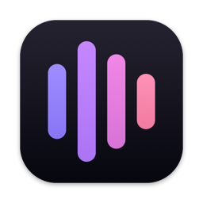
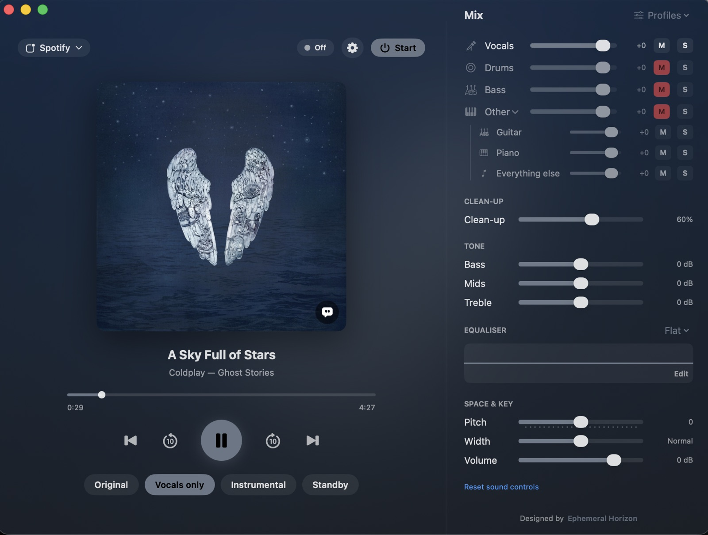

  

<h1 align="center">Kairos</h1>

Hear any song your way, with control over every part of it.

  <a href="https://github.com/KairosFM/Kairos/releases/latest/download/Kairos.dmg"><b>Download for Mac</b></a>
  &nbsp;·&nbsp;
  <a href="https://kairosfm.github.io/Kairos/">Website</a>

Kairos sits between your music apps and your speakers. It listens to the apps you choose, quietens them, splits the sound into vocals, drums, bass and everything else, and plays your mix a few seconds later. All of it happens on your Mac.

- Switch between Original, Vocals only and Instrumental, or set each part yourself
- Clean-up for voices, bass/mids/treble, pitch and stereo width
- Nothing is recorded, saved or uploaded

**Requirements:** macOS 14.2 or later. Apple Silicon recommended.

**First time opening:** if macOS says it can't verify Kairos, open System Settings → Privacy & Security and click **Open Anyway**.

This repository hosts the website and the downloads. The app's source code is not public.

Made by Ephemeral Horizon. Source separation by [HTDemucs](https://github.com/facebookresearch/demucs) (Meta AI, MIT licence).
